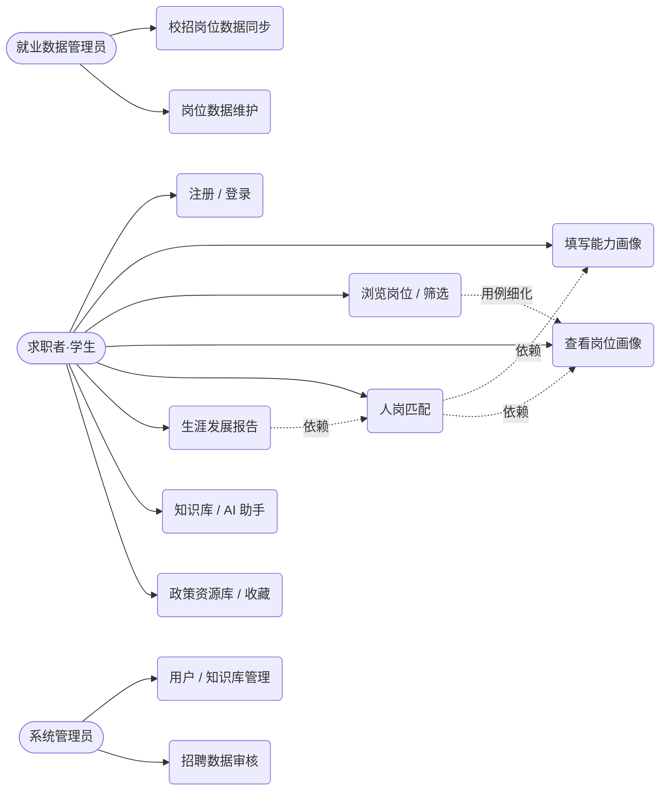
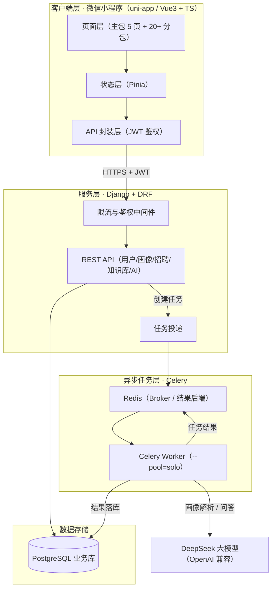
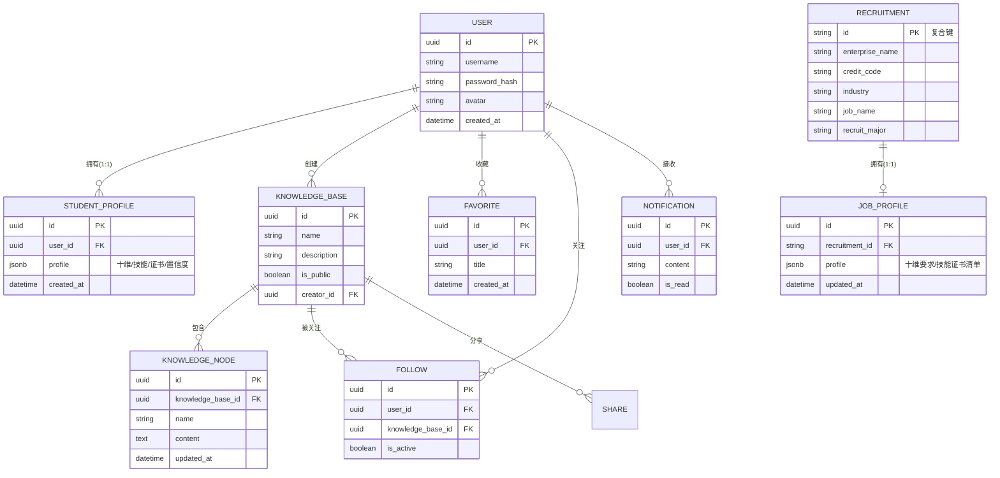
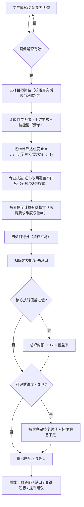
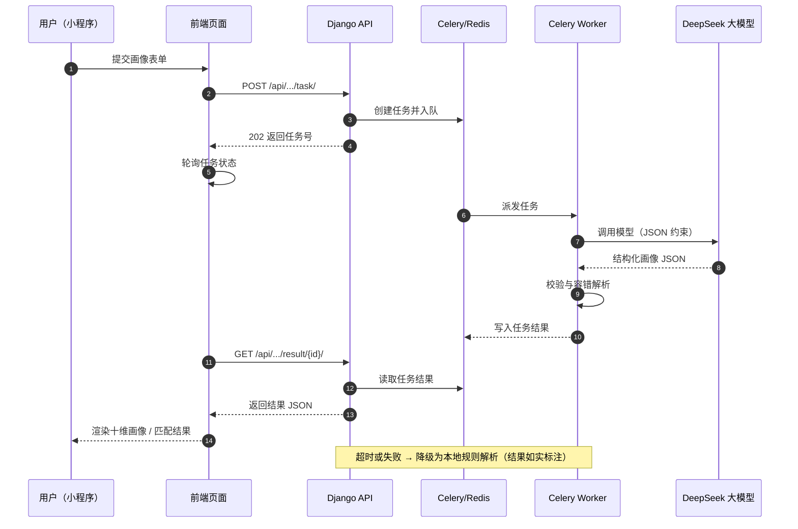

# 图源（Mermaid）— 用于作品说明文档插图

> 使用方法（二选一）：
>
> 1. 打开 <https://mermaid.live>，把下面对应代码块粘贴进去 → 右侧预览 → 右上角 `Export` → `PNG`，即可插入 Word；
> 2. VS Code 安装 `Markdown Preview Mermaid Support` 插件，直接预览并截图。
>
> 导出建议：宽度 ≥ 1200px，导出后统一放到文档的图注下方。

---

## 图 2-1 系统用例图

---

## 图 3-1 系统总体架构图

---

## 图 3-2 数据库 E-R 图（简化）

---

## 图 3-3 人岗匹配流程图

---

## 图 3-4 AI 异步任务时序图

